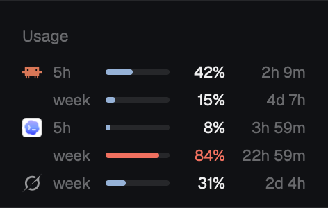

# Usage, a Herdr mod

Claude, Codex and Grok subscription limits in the Herdr sidebar: percent used and time to reset, read from what the CLIs already leave on disk.

To add it, give your agent this repo's URL and ask it to add the mod. What it does, what it reads and how to build it are in [RECIPE.md](RECIPE.md).
