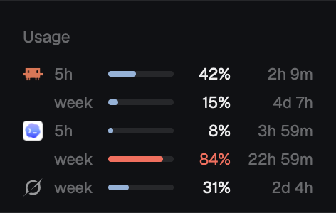

# Usage

A small sidebar block that shows how much of your Claude, Codex and Grok subscription limits you have used: one line per limit window with a bar, the percent used and the time until it resets. It reads only what the three CLIs already leave on disk, so it never touches a login and never calls the network.



## What you see

A block on the `chrome` background with a 1px `border` line on top, text at 11px.

- **Header**, 41px tall, 16px side padding: the word "Usage" at 11.5px, medium weight, `dim`. If the numbers can't be read, "can't read" in `blocked` on the right.
- **Lines**, 20px each, 8px side padding on the list and 8px on each line, 8px gaps. One line per limit window, grouped by provider in the order Claude, Codex, Grok. Left to right:
  - the provider's logo, 14px, on its first line only (later lines of the same provider leave the 14px empty). Claude and Codex are full-color pictures (`icons/claude.svg`, `icons/codex.svg`); Grok is a one-color glyph (`icons/grok.svg`) in `muted`.
  - the window's name, 30px wide, `dim`: `5h`, `week`, `month`, `day`, or `limit` when unknown.
  - a bar that takes the remaining width: 4px tall, radius 2, track in `border`, fill in `accent`, as wide as the percent used (never under 2%).
  - the percent used, 32px wide, right-aligned, `foreground`.
  - the time until reset, 50px wide, right-aligned, `dim`, never wrapping: `49m`, `22h 59m`, `4d 7h`.
- From **80% used** the fill and the percent turn `blocked`.
- A window whose reset time has passed shows an empty bar, `–` for the percent and the word `reset`.
- A provider with nothing on disk still gets one line: its logo, an empty bar and `–`.
- **Narrower than 160px** (a sidebar collapsed to a rail): the header keeps its height but loses its text, and each line is just the logo and the percent, centered.

The block's height follows its lines: 41 + 20 per line + 8. Three to five lines in practice (129px for the common four).

## How it behaves

- It re-reads the numbers once a minute and on start. Nothing else moves; there is no animation.
- Hovering a line highlights it (`hover` background, radius 5) and shows a tooltip:
  - normal: `Codex week: 84% used, resets Wed 14:20. Read 3h 0m ago. 12,000 credits.` The last part is the Codex credit balance or the Grok plan name, when known.
  - past its reset: `Grok week: was 23% used, but that window reset Sun 09:10. Updates when Grok next runs.`
  - nothing on disk: `Grok: no usage on disk yet. It shows up after Grok next runs.`
- Clicks do nothing. Agent statuses play no part.
- Every number is as fresh as that CLI's last run, not live. A CLI you haven't opened since its window reset shows `reset` until you run it again.

## Built from

One mod, `mods/usage/`, four files:

- `mod.json`: `{ "place": "left", "size": 268, "title": "Usage" }`.
- `main.js`: the view. Uses `exec`, `appHome`, `theme`, `layout`, `run` and `props` from `herdr`. Every 60 s (`cx.timer.every`) it runs `collect.py` with `exec` (`/usr/bin/python3` first, then `python3`, 10 s timeout) and parses its JSON. The root has `on_size_change` to know its own width for the rail. When the layout has a block with id `usage` holding this mod at a fixed `px` height, it calls `layout.resize { id: "usage", px }` whenever the line count changes; otherwise it leaves sizes alone.
- `collect.py` (Python 3.9+, standard library only): prints `{ claude, codex, grok }`, each `{ windows: [{ label, used, resets }], seen, note? }` or `null`. `used` is a percent, `resets` and `seen` are epoch seconds. It reads:
  - **Claude**: `~/.claude/usage-limits.json`, written by `statusline.py` (below). Windows `five_hour` and `seven_day`, each with `used_percentage` and `resets_at`.
  - **Codex**: the newest `~/.codex/sessions/<yyyy>/<mm>/<dd>/rollout-*.jsonl` (last 14 day folders, last 2 MB of each file) for the last line with `rate_limits`. `primary` and `secondary` each have `used_percent`, `window_minutes` (300 is `5h`, 10080 is `week`) and `resets_at`; `credits.balance` becomes the note.
  - **Grok**: the last `billing: fetched credits config` line of `~/.grok/logs/unified.jsonl`. `ctx.config.creditUsagePercent` (left out when it is zero), `ctx.config.currentPeriod.type` and `.end`, and `ctx.subscriptionTier` for the note.
- `statusline.py`: a Claude Code status line command. Claude Code passes it JSON on stdin; it saves the `rate_limits` part to `~/.claude/usage-limits.json` (written to a temp file, then renamed) and prints nothing, so no status line appears. Given one argument, it runs that as a shell command with the same stdin and passes its output through, which is how it wraps a status line the person already has.

Props: `{ "demo": true }` shows made-up numbers for every window; `{ "demo": "edge" }` shows a window past its reset and a provider with nothing on disk. Both come from `collect.py --demo[=edge]`.

Art: none of its own. The three logos are Herdr's, from `icons/`.

**Tell the person before adding it:** this mod runs a program (`python3`) once a minute, reads files outside its folder (`~/.claude/usage-limits.json`, `~/.codex/sessions`, `~/.grok/logs/unified.jsonl`), and needs one change to their Claude Code settings. It does not use the network.

**The Claude Code change** (ask first, it edits `~/.claude/settings.json`):

```json
"statusLine": {
  "type": "command",
  "command": "python3 ~/.config/herdr-app/mods/usage/statusline.py"
}
```

If they already have a `statusLine`, keep it by wrapping it: `"command": "python3 ~/.config/herdr-app/mods/usage/statusline.py '<their command>'"`. Never replace theirs. Without this step the Claude line stays at `–`.

**Placing it in a sidebar** instead of its own column: add a block to the sidebar column of a personal layout, above the footer, and hide or remove the docked column.

```json
{ "id": "usage", "type": "block", "content": { "mod": "usage" }, "size": { "px": 129 } }
```

## Watch out

- Write `mod.json` before `main.js`. Herdr docks a new mod the first time it sees the folder; with no `mod.json` yet it lands as a 320px column on the right, and that block has to be removed from the layout by hand.
- The Grok number is scraped from a log line, not an API. Its shape already changed between Grok CLI 1.0.62 and 1.0.77 (the percent is now left out at zero). If the line disappears, Grok shows `reset` or `–` forever; nothing else breaks.
- Claude Code only includes `rate_limits` for subscription logins, and may send one window or two. An API-key login never fills the Claude line.
- Codex with an API key has no `rate_limits` either.
- Round the percent before comparing with 80, so a line showing "80%" is always in the warning color.
- The reset column must not wrap: `22h 59m` does not fit in 44px at 11px and breaks the line height. 50px and `whitespace_nowrap()`.
- Don't decide the rail from a layout node's size; the mod may sit in any column. Use the root's `on_size_change` width.
- Only resize a block called `usage` that really holds this mod. Calling `layout.resize` on anything else changes the person's layout.
- `exec("python3", ...)` can hit a broken shim on macOS; try `/usr/bin/python3` first.
- Tooltips have not been checked on screen (a screenshot can't hover). The text is built for every case above, but its look is whatever Herdr's `.tooltip()` gives.
- Linux and Windows are untested. The paths are the CLIs' defaults; a relocated `CODEX_HOME` or Grok home is not followed.

## Done when

- `herdr-app check ~/.config/herdr-app/mods/usage` passes and `herdr-app status` lists no errors.
- `python3 mods/usage/collect.py` prints one JSON object with the keys `claude`, `codex` and `grok`.
- `echo '{"rate_limits":{"seven_day":{"used_percentage":15,"resets_at":1794672000}}}' | python3 mods/usage/statusline.py` prints nothing and writes `~/.claude/usage-limits.json`; with `'echo hi'` as an argument it also prints `hi`.
- With props `{ "demo": true }`, a screenshot (`herdr-app shot`) shows five lines: Claude 5h 42% and week 15%, Codex 5h 8% and week 84% in the warning color, Grok week 31%, none of them wrapped.
- With props `{ "demo": "edge" }`, it shows Claude 5h 100% and week 80% both in the warning color, Codex `–` with `reset`, and Grok with a logo, an empty bar and `–`.
- With the block narrower than 160px, each line is a logo and a percent, and the word "Usage" is gone.
- In a sidebar block with id `usage`, switching between the two demos changes the block's height from 149px to 129px.
- After a Claude Code session has drawn its prompt once, the Claude line shows a percent instead of `–`.
